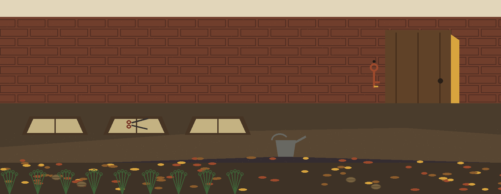
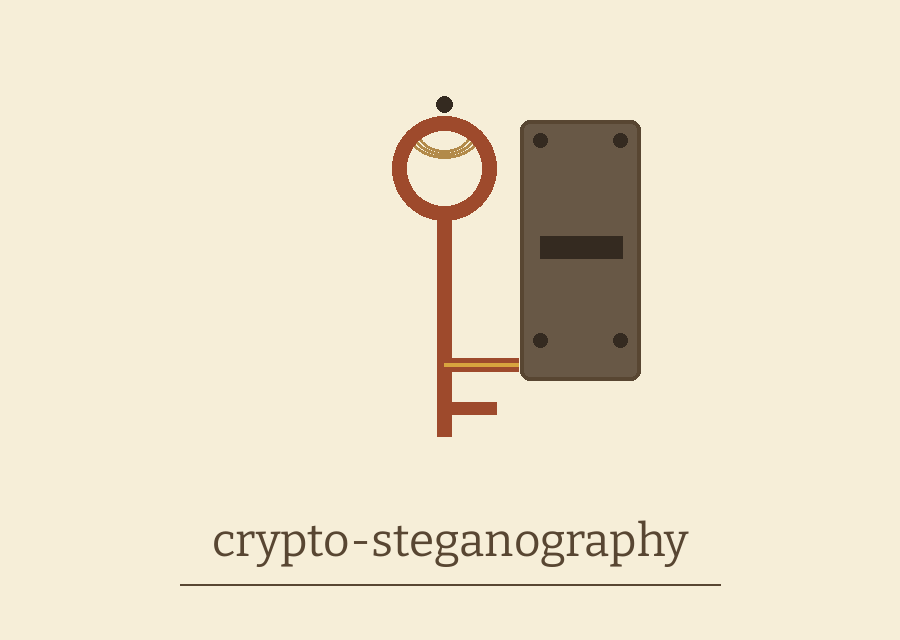
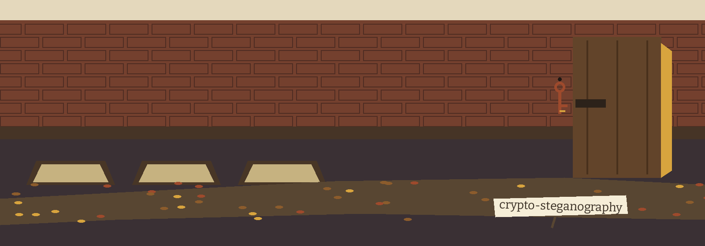
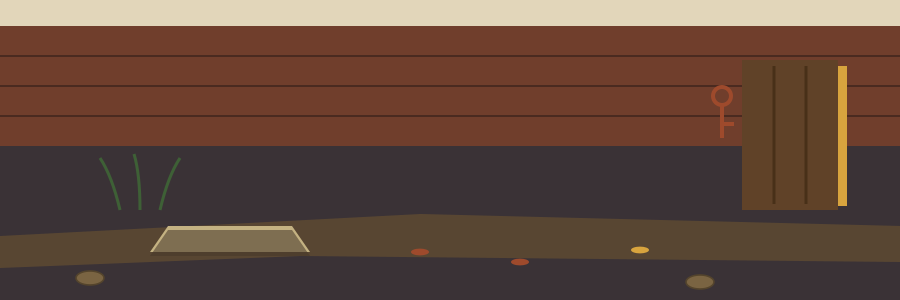
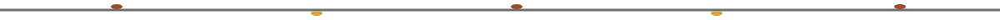
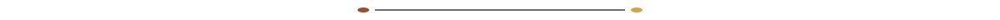
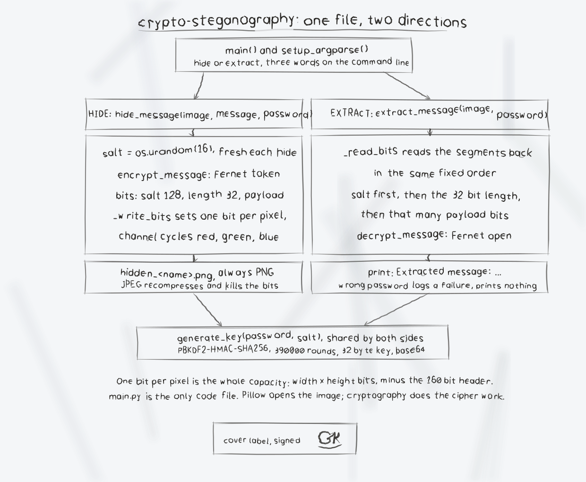

# crypto-steganography

Title block: the name above is set in Crete Round in autumn rust on a cream plate, with a loam rule beneath it and one small door key at the left of the first heading only, in the manner of a herbarium specimen label.









# crypto-steganography

A command line tool that hides text inside an image file and extracts it again, using least significant bit (LSB) steganography. The text is encrypted before it is hidden.

## How it works

- A random 16 byte salt is generated for each hide operation.
- A 256 bit key is derived from the password and the salt with PBKDF2-HMAC-SHA256 (390000 iterations).
- The message is encrypted with Fernet (from the `cryptography` package).
- The salt (128 bits), the encrypted message length (32 bits), and the encrypted message are written one bit per pixel into the least significant bits of the image, in that order.
- Extraction reads the salt and length back, derives the same key from the supplied password, and decrypts the message.


## Requirements

- Python 3
- Pillow and cryptography, listed in `requirements.txt`



> Frame note: encryption happens before hiding, not as part of it. The message is encrypted first, and only the ciphertext goes into the pixels.

## Install

```bash
git clone https://github.com/ShadowGuard-AI/crypto-steganography.git
cd crypto-steganography
pip install -r requirements.txt
```


## Usage

Hide a message:

```bash
python3 main.py hide test.png "hello secret world" REDACTED
```

This writes `hidden_test.png` in the current directory and logs `Message hidden successfully. Image saved as hidden_test.png`.

Extract a message:

```bash
python3 main.py extract hidden_test.png REDACTED
```

Redaction note: the live README printed one concrete password value in the hide example and again in the extract example. Both occurrences are redacted in this re-skin and on the site. Put your own password in that position when you run the tool.

On success this prints, for the example above:

```text
Extracted message: hello secret world
```

Show help:

```bash
python3 main.py --help
python3 main.py hide --help
python3 main.py extract --help
```


> Frame note: inside each segment the colour channel cycles red, green, blue by bit position, and each new segment restarts that cycle at red.

## Parameters

- `hide <image> <message> <password>`: hide `message` in `image`, protected by `password`.
- `extract <image> <password>`: extract the hidden message from `image` using `password`.
- `-h`, `--help`: show help and exit.


> Frame note: output always lands in the current directory as a PNG, overwriting a same named file without asking.

## Limitations

- Output is always saved as a PNG file named `hidden_<original base name>.png` in the current directory, whatever the input format was. PNG is required because lossy formats such as JPEG recompress pixels and destroy the hidden data. Extract from the PNG output, not from a JPEG copy of it.
- Capacity is one bit per pixel, minus a 160 bit header (salt plus length). A 200 by 200 pixel image therefore holds at most 39840 bits, about 4980 bytes, of encrypted data, and the Fernet token is larger than the plain message. Hiding into an image that is too small logs `Error: Image is not large enough to hide the message.` and writes no output file.
- A wrong password logs a decryption failure and prints no extracted message.
- Extracting from an image that contains no valid hidden message logs an error and prints no extracted message.
- There are no bundled tests. The hide and extract round trip above was verified by hand.


> Frame note: an empty message hides fine and then fails at extraction. A JPEG copy destroys the payload, because lossy recompression destroys the hidden bits.

## License

Copyright (c) ShadowStrikeHQ


## Diagrams and maps

I drew the system out in [crypto-steganography-Visuals](crypto-steganography-Visuals/): an architecture diagram, a data-flow diagram of the three segment layout, a flowchart of a run, and a product map, with the written product map, statistics with citations, and the roadmap in [VISUAL.md](crypto-steganography-Visuals/VISUAL.md). Every sheet also ships as a PNG photograph of the paper page beside its SVG.




## Frame notes, gathered on the round

The buttons of this re-skin read Hide the Message, Extract the Message, and Show the Round Notes. Its headings read Encrypted Before It Is Hidden, Three Segments in a Fixed Order, One Bit per Pixel, PNG Out or Nothing, and Too Small Means No File. The licence line above stands as printed in the live README and is flagged, not corrected: it names ShadowStrikeHQ, which does not match the organisation in the install line. Beside it sits a separate fact. The repository LICENSE file carries the MIT License. Its holder line gives a pen name together with a single initial for the remaining name. That fact is recorded. The initial is not expanded.
